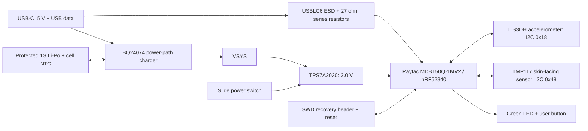

# Architecture — Rev A engineering prototype

The design is a wrist-worn BLE sensor board with a 40 mm near-circular outline, a flat USB edge, four copper layers and nominal 1.0 mm thickness. It is a review prototype, not a fabrication release. USB-C provides 5 V charging and USB full-speed data. Wireless charging and the optional buzzer are omitted.

## System blocks

## Circuit decisions

- The BLE module avoids a discrete RF matching network. Its antenna faces the north edge. All four copper layers have an explicit no-track/no-via/no-pour antenna keepout spanning the board width through y=85.05 mm (3.8 mm inward from the module north body edge at y=81.25 mm). Battery, enclosure metal and wrist effects still need physical RF evaluation.
- LIS3DH provides three-axis acceleration and motion wake, without a gyroscope. Its NC pins are unconnected, unused ADC inputs grounded, CS high and SA0 low through 100 kohm.
- TMP117 is on the bottom face, away from the charger. Its exposed pad has no paste opening and is unconnected. A local plane exclusion is an initial thermal isolation choice; it does not establish skin accuracy. The enclosure needs an electrically insulating thermal contact and calibration/settling tests.
- BQ24074 charges a protected 4.2 V single-cell pack at approximately 100 mA (8.87 kohm ISET). A 10 kohm NTC must be thermally attached to the cell. Battery protection is in the required pack, not implemented on the PCB. Pack MPN, NTC curve and harness remain release blockers.
- USB starts at the charger's USB100 input limit (EN1=EN2=0). Firmware may select USB500 only after enumeration grants the current. Both EN pins high suspend input. Autonomous charging from a host while the MCU is switched off needs a USB suspend/current-policy review before release; this prototype is not declared USB compliant.
- The slide switch controls regulator EN; it does not disconnect the battery or charger. Charger and divider leakage continue while off. The 3.0 V LDO supplies logic; its dropout at low cell voltage must be included in usable-capacity tests.
- A 1 Mohm / 1 Mohm divider scales battery voltage by 0.5; 100 nF gives a 50 ms time constant. Configure the ADC for at least a 2.1 V input range, allow settling and calibrate divider error.
- Native USB supports a firmware bootloader and CDC logging. Initial bootloader installation and breakpoint debugging use the separate SWD connector. USB data alone does not provide hardware SWD debugging.

## Initial operating budget (assumptions, not measurements)

| Mode | Planning current from battery | Basis |
|---|---:|---|
| Advertising / sensor logging | 0.5–2 mA average | Firmware and connection interval dependent |
| BLE radio / MCU burst | Reserve 30 mA logic peak | Design allowance; measure actual waveform |
| LED enabled | About 1 mA extra | 1 kohm resistor, green LED |
| Off | Not specified yet | Charger, divider, pack protection and LDO shutdown leakage must be measured |

For a planning-only 200 mAh cell and 80% usable capacity, 0.5–2 mA implies about 80–320 hours. This is arithmetic sensitivity, not a runtime claim. Charging at 100 mA takes more than 2 hours once taper and system load are included. No battery is released for purchase yet.

## Physical stack and assembly

F.Cu signals/components / In1.Cu main GND reference (with local ground bridges) / In2.Cu signal escapes with GND fill / B.Cu signals/skin sensor/test pads. Nominal 1.0 mm FR-4; exact dielectric stack, impedance, copper weights and fabrication tolerances await the selected fabricator. Minimum board constraints: 0.15 mm track/clearance, 0.60 mm through via with 0.30 mm drill, 0.25 mm copper-to-edge. No blind or microvias are planned. Filled/capped via-in-pad is not authorized; any remaining overlap blocks release.

This board needs an enclosure, strap, insulation, connector access and mechanical fit checks. It is intended for skin-temperature trends; no core-temperature or medical performance claim is made.
